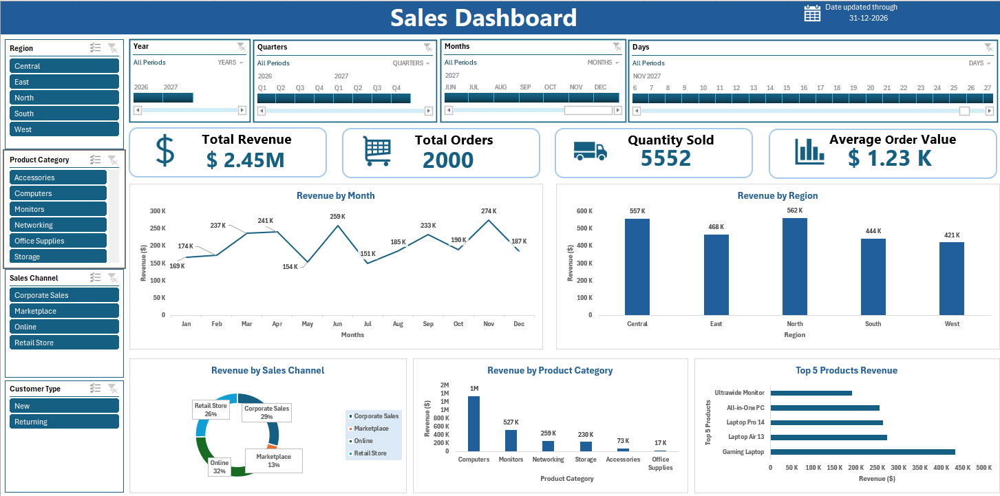

# Sales Finance Analytics Dashboard
An Excel dashboard for exploring sales performance across regions, product categories, sales channels, customer types, and dates.
## Dashboard preview

## Key metrics shown
- Total revenue: $2.45M
- Total orders: 2,000
- Quantity sold: 5,552
- Average order value: $1.23K
These figures reflect the dashboard image and may change when filters or source data are updated.
## Dashboard features
- Interactive filters for region, product category, sales channel, customer type, and date
- Revenue trends by month
- Revenue comparison by region
- Revenue by sales channel and product category
- Top five products by revenue
## Files
- `dashboard/sales_dashboard.xlsx` — Excel dashboard workbook
- `images/sales_dashboard_preview.png` — dashboard screenshot
- `data/README.md` — notes about the source data
## How to use
1. Download `dashboard/sales_dashboard.xlsx`.
2. Open it in Microsoft Excel.
3. Use the dashboard filters to explore the results.
## Data and privacy
Add source data only if you have permission to share it. Remove personal, confidential, or otherwise sensitive information before uploading.
## Tools
- Microsoft Excel
- GitHub
